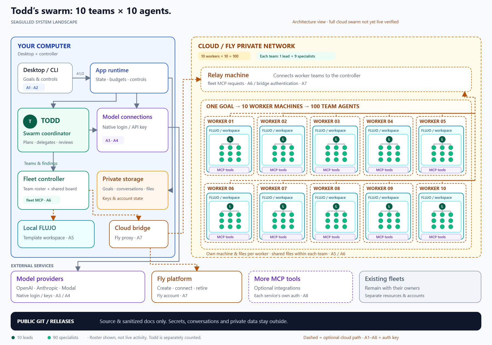

# seagulled

Talk to Todd. He delegates your goal to a team, checks what they bring back, and occasionally comes in and shits on everything.
Download the Windows portable app from [Releases](https://github.com/flujo-app/seagulled/releases). Open it and tell Todd what you want done. 

Version 0.2.0 includes the public [FACTORY 0.3.0 SDK](https://github.com/flujo-app/FACTORY/releases/tag/v0.3.0), FLUJO 3.48.1 and its cloud SDK. The Windows download bundles the product runtime and account helpers. FACTORY records durable dispatch; the recovered swarm engine owns Worker scheduling and retirement.

Goals default to ten requested Workers and ten total conversations per Worker. Requested counts, observed activity and verified execution remain separate. Budgets, model choices and pause/stop controls persist privately. Provider billing can remain unknown after work ends.

The matching FLUJO Worker image is verified against an immutable release digest. Release checks use local tests, packaged application checks and read-only source/image verification. No fresh live cloud run was performed for 0.2.0; earlier dated acceptance does not establish current provider availability or billed spending.

See [build instructions](BUILD.md) for the exact public dependencies and source package.

https://github.com/user-attachments/assets/e9a59051-38ae-480f-ab02-e69adafc685d

This is an independent, unofficial parody interface, with a fictional Todd persona. No affiliation or endorsement is implied.
